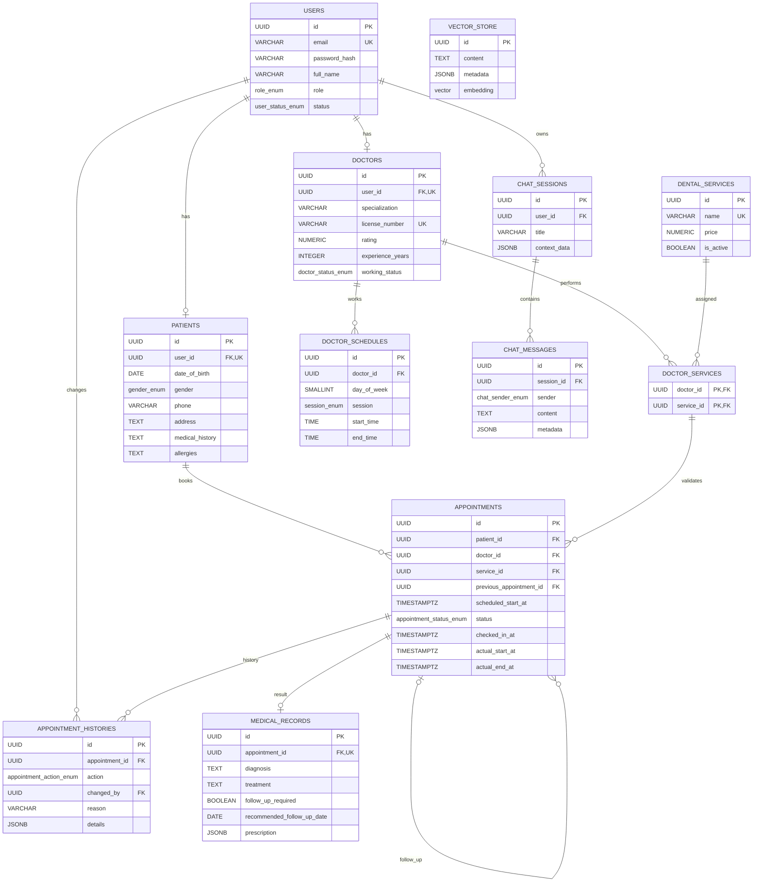

# THIẾT KẾ CƠ SỞ DỮ LIỆU TỐI GIẢN – 12 BẢNG

## HỆ THỐNG QUẢN LÝ PHÒNG KHÁM NHA KHOA TÍCH HỢP AI CHATBOT

**Database:** PostgreSQL 16+  
**Backend:** Spring Boot 3.x / Java 21 / Spring Data JPA / Hibernate / Flyway  
**AI:** Spring AI + Gemini + pgvector  
**Múi giờ nghiệp vụ:** `Asia/Ho_Chi_Minh`

---

# 1. MỤC TIÊU TỐI ƯU

Phiên bản này tối ưu cho phạm vi **đồ án/demo**, nhưng vẫn giữ các chức năng đã chốt:

- Đăng ký / đăng nhập / phân quyền `ADMIN`, `DOCTOR`, `PATIENT`.
- Quản lý hồ sơ bệnh nhân và bác sĩ.
- Quản lý dịch vụ và bảng giá.
- Mapping bác sĩ ↔ dịch vụ.
- Lịch làm việc bác sĩ theo tuần.
- Slot cố định 60 phút.
- Đặt lịch trước ít nhất 3 giờ.
- Hủy và đổi lịch trước ít nhất 90 phút.
- Check-in / đang khám / hoàn tất / no-show.
- Theo dõi giờ khám thực tế khi bác sĩ trễ.
- Tái khám liên kết với lần khám trước.
- Bệnh án và đơn thuốc.
- Chatbot nhiều phiên.
- RAG với PostgreSQL + pgvector.
- Chatbot lấy bác sĩ, dịch vụ, bảng giá và slot từ PostgreSQL.

## 1.1 Các bảng được loại bỏ

### `refresh_tokens` — bỏ

Bản demo chỉ dùng JWT Access Token. Token hết hạn thì người dùng đăng nhập lại.

### `doctor_schedule_overrides` — bỏ

Bản demo dùng lịch tuần cố định. Nếu bác sĩ không làm một buổi thì không có row tương ứng trong `doctor_schedules`.

Ngày nghỉ hoặc đổi lịch đột xuất được xem là hướng mở rộng.

### `prescriptions` — bỏ

Đơn thuốc được gộp vào:

```text
medical_records.prescription JSONB
```

Vẫn hỗ trợ nhiều thuốc trong một lần khám nhưng giảm một bảng riêng.

---

# 2. DANH SÁCH 12 BẢNG CUỐI CÙNG

```text
1.  users
2.  patients
3.  doctors
4.  dental_services
5.  doctor_services
6.  doctor_schedules
7.  appointments
8.  appointment_histories
9.  medical_records
10. chat_sessions
11. chat_messages
12. vector_store
```

Theo nhóm:

```text
AUTH
└── users

PROFILE
├── patients
└── doctors

SERVICE & SCHEDULE
├── dental_services
├── doctor_services
└── doctor_schedules

APPOINTMENT
├── appointments
└── appointment_histories

CLINICAL
└── medical_records

CHATBOT & RAG
├── chat_sessions
├── chat_messages
└── vector_store
```

---

# 3. DATA DICTIONARY

## 3.1 `users`

Lưu thông tin chung của mọi tài khoản.

| Cột | PostgreSQL | Null | Ràng buộc / Default | Ý nghĩa |
|---|---|---:|---|---|
| `id` | `UUID` | No | PK, `uuid_generate_v4()` | ID user |
| `email` | `VARCHAR(255)` | No | UNIQUE | Email đăng nhập |
| `password_hash` | `VARCHAR(255)` | No |  | BCrypt hash |
| `full_name` | `VARCHAR(150)` | No |  | Họ tên dùng chung |
| `role` | `role_enum` | No |  | ADMIN / DOCTOR / PATIENT |
| `status` | `user_status_enum` | No | `ACTIVE` | Trạng thái tài khoản |
| `created_at` | `TIMESTAMPTZ` | No | `now()` | Tạo |
| `updated_at` | `TIMESTAMPTZ` | No | `now()` | Cập nhật |

### Tối ưu

`full_name` được đưa lên `users` để không lưu trùng ở `patients` và `doctors`.

---

## 3.2 `patients`

Chỉ lưu thông tin riêng của bệnh nhân.

| Cột | Type | Null | Key / Default | Ý nghĩa |
|---|---|---:|---|---|
| `id` | `UUID` | No | PK | ID bệnh nhân |
| `user_id` | `UUID` | No | UNIQUE FK → users | Quan hệ 1-1 |
| `date_of_birth` | `DATE` | Yes |  | Ngày sinh |
| `gender` | `gender_enum` | No | `UNSPECIFIED` | Giới tính |
| `phone` | `VARCHAR(30)` | Yes |  | Số điện thoại |
| `address` | `TEXT` | Yes |  | Địa chỉ |
| `medical_history` | `TEXT` | Yes |  | Tiền sử bệnh |
| `allergies` | `TEXT` | Yes |  | Dị ứng |
| `created_at` | `TIMESTAMPTZ` | No | `now()` | Tạo |
| `updated_at` | `TIMESTAMPTZ` | No | `now()` | Cập nhật |

`allergies` được giữ riêng vì bác sĩ cần xem trong lúc khám.

---

## 3.3 `doctors`

Chỉ lưu thông tin nghề nghiệp của bác sĩ.

| Cột | Type | Null | Key / Default | Ý nghĩa |
|---|---|---:|---|---|
| `id` | `UUID` | No | PK | ID bác sĩ |
| `user_id` | `UUID` | No | UNIQUE FK → users | Tài khoản |
| `specialization` | `VARCHAR(150)` | No | Indexed | Chuyên khoa |
| `license_number` | `VARCHAR(100)` | No | UNIQUE | Chứng chỉ hành nghề |
| `bio` | `TEXT` | Yes |  | Tiểu sử |
| `rating` | `NUMERIC(2,1)` | No | `0.0`, CHECK 0..5 | Điểm đánh giá |
| `experience_years` | `INTEGER` | No | `0`, CHECK >= 0 | Kinh nghiệm |
| `working_status` | `doctor_status_enum` | No | `ACTIVE` | Trạng thái làm việc |
| `created_at` | `TIMESTAMPTZ` | No | `now()` | Tạo |
| `updated_at` | `TIMESTAMPTZ` | No | `now()` | Cập nhật |

Không tạo thêm bảng `specializations`, `doctor_profiles`, `ratings` ở bản demo.

---

## 3.4 `dental_services`

Nguồn dữ liệu dịch vụ và giá cho nghiệp vụ + chatbot.

| Cột | Type | Null | Key / Default | Ý nghĩa |
|---|---|---:|---|---|
| `id` | `UUID` | No | PK | ID dịch vụ |
| `name` | `VARCHAR(200)` | No | UNIQUE | Tên dịch vụ |
| `description` | `TEXT` | Yes |  | Mô tả |
| `price` | `NUMERIC(14,2)` | No | CHECK >= 0 | Giá hiện tại |
| `is_active` | `BOOLEAN` | No | `true` | Còn hoạt động |
| `created_at` | `TIMESTAMPTZ` | No | `now()` | Tạo |
| `updated_at` | `TIMESTAMPTZ` | No | `now()` | Cập nhật |

Không nên xóa cứng dịch vụ đã từng được sử dụng; chuyển `is_active=false`.

---

## 3.5 `doctor_services`

Bảng mapping N-N giữa bác sĩ và dịch vụ.

| Cột | Type | Null | Key | Ý nghĩa |
|---|---|---:|---|---|
| `doctor_id` | `UUID` | No | PK/FK → doctors | Bác sĩ |
| `service_id` | `UUID` | No | PK/FK → dental_services | Dịch vụ |

Không cần `id`, `created_at`, `updated_at` vì đây chỉ là bảng liên kết.

---

## 3.6 `doctor_schedules`

Lịch làm việc cố định theo tuần.

| Cột | Type | Null | Key / Default | Ý nghĩa |
|---|---|---:|---|---|
| `id` | `UUID` | No | PK | ID lịch |
| `doctor_id` | `UUID` | No | FK → doctors | Bác sĩ |
| `day_of_week` | `SMALLINT` | No | CHECK 1..7 | Thứ 2 → CN |
| `session` | `session_enum` | No |  | Sáng / chiều |
| `start_time` | `TIME` | No |  | Bắt đầu |
| `end_time` | `TIME` | No | CHECK > start | Kết thúc |
| `created_at` | `TIMESTAMPTZ` | No | `now()` | Tạo |
| `updated_at` | `TIMESTAMPTZ` | No | `now()` | Cập nhật |

UNIQUE:

```text
(doctor_id, day_of_week, session)
```

Không dùng `is_off`. Nếu bác sĩ nghỉ một buổi thì không có row của buổi đó.

Không dùng `doctor_schedule_overrides` trong bản demo.

---

## 3.7 `appointments`

Bảng trung tâm của hệ thống.

| Cột | Type | Null | Key / Default | Ý nghĩa |
|---|---|---:|---|---|
| `id` | `UUID` | No | PK | ID lịch hẹn |
| `patient_id` | `UUID` | No | FK → patients | Bệnh nhân |
| `doctor_id` | `UUID` | No | FK kép qua doctor_services | Bác sĩ |
| `service_id` | `UUID` | No | FK kép qua doctor_services | Dịch vụ |
| `previous_appointment_id` | `UUID` | Yes | FK self | Lịch trước nếu tái khám |
| `scheduled_start_at` | `TIMESTAMPTZ` | No | Indexed | Thời gian hẹn |
| `status` | `appointment_status_enum` | No | `BOOKED` | Trạng thái |
| `checked_in_at` | `TIMESTAMPTZ` | Yes |  | Check-in thực tế |
| `actual_start_at` | `TIMESTAMPTZ` | Yes |  | Bắt đầu khám thực tế |
| `actual_end_at` | `TIMESTAMPTZ` | Yes |  | Kết thúc thực tế |
| `created_at` | `TIMESTAMPTZ` | No | `now()` | Tạo |
| `updated_at` | `TIMESTAMPTZ` | No | `now()` | Cập nhật |

### Tối ưu thời gian

Không lưu riêng:

```text
appointment_date
start_time
end_time
```

Chỉ lưu:

```text
scheduled_start_at TIMESTAMPTZ
```

Vì slot luôn cố định 60 phút:

```text
scheduled_end = scheduled_start_at + 60 phút
```

Nhờ đó các rule dễ xử lý:

```text
Đặt lịch: scheduled_start_at >= now + 180 phút
Hủy:      scheduled_start_at >= now + 90 phút
Đổi:      scheduled_start_at >= now + 90 phút
```

### Chống trùng slot

Lịch `CANCELLED` phải giải phóng slot nên dùng partial unique index:

```sql
CREATE UNIQUE INDEX ...
ON appointments(doctor_id, scheduled_start_at)
WHERE status <> 'CANCELLED';
```

---

## 3.8 `appointment_histories`

Audit log tối giản.

| Cột | Type | Null | Key / Default | Ý nghĩa |
|---|---|---:|---|---|
| `id` | `UUID` | No | PK | ID |
| `appointment_id` | `UUID` | No | FK → appointments | Lịch |
| `action` | `appointment_action_enum` | No |  | Hành động |
| `changed_by` | `UUID` | Yes | FK → users | Người thao tác |
| `reason` | `VARCHAR(100)` | Yes |  | Lý do |
| `details` | `JSONB` | No | `{}` | Chi tiết thay đổi |
| `created_at` | `TIMESTAMPTZ` | No | `now()` | Thời điểm |

Thay vì nhiều cột `old_*`, `new_*`, dữ liệu thay đổi được gom vào JSONB.

Ví dụ đổi lịch:

```json
{
  "old_start": "2026-10-15T14:00:00+07:00",
  "new_start": "2026-10-15T16:00:00+07:00"
}
```

Ví dụ hủy:

```json
{
  "old_status": "BOOKED",
  "new_status": "CANCELLED"
}
```

`reason` có thể là:

```text
PATIENT_REQUEST
DOCTOR_DELAY
EMERGENCY
```

---

## 3.9 `medical_records`

Quan hệ 1-1 với Appointment.

| Cột | Type | Null | Key / Default | Ý nghĩa |
|---|---|---:|---|---|
| `id` | `UUID` | No | PK | ID bệnh án |
| `appointment_id` | `UUID` | No | UNIQUE FK | Lịch khám |
| `diagnosis` | `TEXT` | No |  | Chẩn đoán |
| `treatment` | `TEXT` | No |  | Điều trị |
| `treatment_plan` | `TEXT` | Yes |  | Kế hoạch |
| `notes` | `TEXT` | Yes |  | Ghi chú |
| `follow_up_required` | `BOOLEAN` | No |  | Có tái khám |
| `recommended_follow_up_date` | `DATE` | Yes |  | Ngày đề xuất |
| `follow_up_note` | `TEXT` | Yes |  | Dặn dò tái khám |
| `prescription` | `JSONB` | No | `[]` | Đơn thuốc |
| `created_at` | `TIMESTAMPTZ` | No | `now()` | Tạo |
| `updated_at` | `TIMESTAMPTZ` | No | `now()` | Cập nhật |

Không lặp `patient_id` và `doctor_id` vì có thể truy qua Appointment.

### Prescription JSONB

Ví dụ:

```json
[
  {
    "medicationName": "Paracetamol 500mg",
    "dosage": "1 viên",
    "quantity": 10,
    "instructions": "Uống sau ăn khi đau"
  }
]
```

Không cần bảng `prescriptions` riêng trong demo.

---

## 3.10 `chat_sessions`

Một user có nhiều phiên chat.

| Cột | Type | Null | Key / Default | Ý nghĩa |
|---|---|---:|---|---|
| `id` | `UUID` | No | PK | ID phiên |
| `user_id` | `UUID` | No | FK → users | Chủ phiên |
| `title` | `VARCHAR(255)` | Yes |  | Tiêu đề |
| `context_data` | `JSONB` | No | `{}` | Context triệu chứng / intent hiện tại |
| `created_at` | `TIMESTAMPTZ` | No | `now()` | Tạo |
| `updated_at` | `TIMESTAMPTZ` | No | `now()` | Cập nhật |

Ví dụ:

```json
{
  "intent": "SYMPTOM_CONSULTATION",
  "location": "LOWER_LEFT",
  "painLevel": "SEVERE",
  "duration": "3 days",
  "swelling": true
}
```

---

## 3.11 `chat_messages`

| Cột | Type | Null | Key / Default | Ý nghĩa |
|---|---|---:|---|---|
| `id` | `UUID` | No | PK | ID message |
| `session_id` | `UUID` | No | FK → chat_sessions | Phiên |
| `sender` | `chat_sender_enum` | No |  | USER / ASSISTANT / SYSTEM |
| `content` | `TEXT` | No |  | Nội dung |
| `metadata` | `JSONB` | No | `{}` | Metadata message |
| `created_at` | `TIMESTAMPTZ` | No | `now()` | Thời điểm |

Không tạo các bảng riêng cho symptom, doctor suggestion hoặc slot suggestion; metadata JSONB là đủ cho demo.

---

## 3.12 `vector_store`

Kho tri thức RAG.

| Cột | Type | Null | Key / Default | Ý nghĩa |
|---|---|---:|---|---|
| `id` | `UUID` | No | PK | Chunk |
| `content` | `TEXT` | No |  | Nội dung chunk |
| `metadata` | `JSONB` | No | `{}` | Metadata tài liệu |
| `embedding` | `vector(768)` | No | HNSW | Embedding |

Nếu model embedding thực tế không dùng 768 chiều thì phải đổi dimension trước khi chạy Flyway V1.

---

# 4. ERD MERMAID



`vector_store` là kho RAG độc lập nên không cần FK với các bảng nghiệp vụ.

---

# 5. LUỒNG DỮ LIỆU CHÍNH

## 5.1 Đặt lịch

```text
Patient
  ↓
DentalService
  ↓
DoctorService
  ↓
Doctor
  ↓
DoctorSchedule
  ↓
Sinh slot 60 phút
  ↓
Appointments
```

Spring Boot kiểm tra:

```text
scheduled_start_at >= now + 180 phút
```

Database bảo vệ slot bằng partial unique index.

---

## 5.2 Hủy / đổi lịch

Spring Boot kiểm tra:

```text
scheduled_start_at >= now + 90 phút
```

Hủy:

```text
appointments.status = CANCELLED
appointment_histories.action = CANCEL
```

Đổi:

```text
appointments.scheduled_start_at = giờ mới
appointment_histories.action = RESCHEDULE
```

Nếu slot mới bị tranh chấp, transaction rollback và lịch cũ vẫn giữ nguyên.

---

## 5.3 Check-in và bác sĩ khám quá giờ

```text
BOOKED
  ↓
CHECKED_IN
  ↓
IN_PROGRESS
  ↓
COMPLETED
```

Lưu:

```text
checked_in_at
actual_start_at
actual_end_at
```

Nếu bác sĩ khám quá 60 phút:

- Ca hiện tại vẫn `IN_PROGRESS`.
- Bệnh nhân tiếp theo giữ `CHECKED_IN`.
- Không thay đổi giờ hẹn gốc.
- `actual_start_at` phản ánh giờ bắt đầu thật.

---

## 5.4 Tái khám

```text
Appointment #1
  ↓
MedicalRecord
  ↓
follow_up_required = true
  ↓
Appointment #2
previous_appointment_id = Appointment #1
```

Không bắt buộc phải tạo lịch tái khám ngay khi Check-out.

---

## 5.5 Chatbot

```text
User
  ↓
chat_sessions
  ↓
chat_messages
  ↓
Intent
```

Nếu tư vấn triệu chứng:

```text
context_data
  ↓
vector_store
  ↓
RAG
  ↓
Gemini
```

Nếu hỏi bác sĩ, dịch vụ, bảng giá hoặc slot:

```text
PostgreSQL business tables
```

Không dùng vector store làm nguồn thật cho dữ liệu động.

---

# 6. SPRING DATA JPA / HIBERNATE

## 6.1 Entity cuối cùng

```text
User
Patient
Doctor
DentalService
DoctorService
DoctorSchedule
Appointment
AppointmentHistory
MedicalRecord
ChatSession
ChatMessage
```

`vector_store` nên do Spring AI quản lý, không cần JPA Entity riêng.

---

## 6.2 Enum mapping

Với PostgreSQL native ENUM + Hibernate 6:

```java
@Enumerated(EnumType.STRING)
@JdbcTypeCode(SqlTypes.NAMED_ENUM)
@Column(columnDefinition = "appointment_status_enum")
private AppointmentStatus status;
```

---

## 6.3 JSONB

```java
@JdbcTypeCode(SqlTypes.JSON)
@Column(columnDefinition = "jsonb")
private Map<String, Object> details;
```

Áp dụng cho:

```text
AppointmentHistory.details
ChatSession.contextData
ChatMessage.metadata
MedicalRecord.prescription
```

Với đơn thuốc có thể dùng typed DTO:

```java
public record PrescriptionItem(
    String medicationName,
    String dosage,
    Integer quantity,
    String instructions
) {}
```

---

## 6.4 Appointment time

Java nên dùng:

```java
private OffsetDateTime scheduledStartAt;
private OffsetDateTime checkedInAt;
private OffsetDateTime actualStartAt;
private OffsetDateTime actualEndAt;
```

Hoặc `Instant`.

Không cần lưu `scheduledEndAt` vì:

```java
scheduledStartAt.plusHours(1)
```

---

## 6.5 DoctorService

Không nên dùng `@ManyToMany` trực tiếp.

Khuyến nghị tạo entity `DoctorService` với composite key:

```java
@EmbeddedId
private DoctorServiceId id;
```

Lý do: mapping rõ ràng, dễ query, dễ mở rộng sau này.

---

## 6.6 Transaction đặt lịch

```java
@Transactional
public Appointment book(...) {
    // validate patient
    // validate DoctorService
    // validate DoctorSchedule
    // validate >= 3 hours
    // save appointment
    // save BOOK history
}
```

Nếu unique index conflict:

```text
HTTP 409 CONFLICT
```

---

## 6.7 Transaction đổi lịch

```java
@Transactional
public Appointment reschedule(...) {
    // current status = BOOKED
    // current appointment >= 90 minutes away
    // validate new slot
    // update scheduledStartAt
    // save RESCHEDULE history
}
```

Nếu slot mới bị lấy thì rollback toàn bộ transaction.

---

# 7. BUSINESS CONFIG KHÔNG LƯU THÀNH BẢNG

Không cần thêm bảng `system_settings` cho demo.

Dùng `application.yml`:

```yaml
clinic:
  timezone: Asia/Ho_Chi_Minh

  appointment:
    slot-duration-minutes: 60
    booking-min-advance-minutes: 180
    cancellation-cutoff-minutes: 90
    reschedule-cutoff-minutes: 90
    no-show-grace-minutes: 15
    delay-warning-minutes: 30
```

---

# 8. INDEX STRATEGY

Các index chính:

```text
doctors(specialization)
doctors(working_status)

dental_services(is_active)
lower(dental_services.name)

doctor_services(service_id, doctor_id)

doctor_schedules(doctor_id, day_of_week, session)

appointments(doctor_id, scheduled_start_at, status)
appointments(patient_id, scheduled_start_at DESC)
appointments(previous_appointment_id)

appointment_histories(appointment_id, created_at DESC)
GIN(appointment_histories.details)

chat_sessions(user_id, updated_at DESC)
GIN(chat_sessions.context_data)

chat_messages(session_id, created_at)
GIN(chat_messages.metadata)

HNSW(vector_store.embedding vector_cosine_ops)
GIN(vector_store.metadata)
```

---

# 9. SO SÁNH TRƯỚC VÀ SAU

| Phần | Trước | Sau |
|---|---:|---:|
| Tổng bảng | 15 | **12** |
| Token | `refresh_tokens` | Bỏ |
| Lịch ngoại lệ | `doctor_schedule_overrides` | Bỏ |
| Đơn thuốc | `prescriptions` | JSONB trong `medical_records` |
| Tên | lặp Patient/Doctor | `users.full_name` |
| Appointment date/time | 3 cột | `scheduled_start_at` |
| Audit appointment | nhiều cột old/new | `details JSONB` |
| MedicalRecord patient/doctor | lặp FK | truy qua Appointment |
| Lịch nghỉ | `is_off` | không có row |
| Chat symptom context | phân tán | `chat_sessions.context_data` |

---

# 10. KẾT LUẬN

Schema 12 bảng là điểm cân bằng tốt cho đồ án:

- Ít Entity/Repository/Service hơn.
- Vẫn giữ đúng nghiệp vụ đặt lịch, tái khám, bệnh án và chatbot.
- Dữ liệu động của chatbot vẫn lấy trực tiếp từ PostgreSQL.
- RAG vẫn dùng pgvector.
- Có audit cho lịch hẹn.
- Dễ map với Spring Data JPA.
- Dễ trình bày ERD và giải thích khi bảo vệ đồ án.
